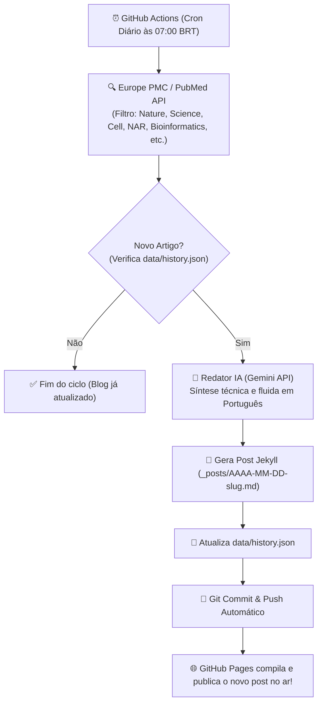

# 🧬 LaBiOmicS · Radar Científico & Blog Automatizado

[](.github/workflows/daily_curator.yml)
[](https://pages.github.com/)
[](https://europepmc.org/)
[](https://labiomics.github.io/)

Plataforma de blog científico estático e autônomo desenvolvido para o **LaBiOmicS (Laboratório de Bioinformática e Ciências Ômicas)**. O sistema monitora diariamente publicações de alto impacto nas áreas do laboratório, sintetiza os artigos em português com inteligência artificial e os publica automaticamente no **GitHub Pages** com custo zero de infraestrutura.

O design foi concebido para dialogar perfeitamente com a identidade visual da página oficial do laboratório ([labiomics.github.io](https://labiomics.github.io/)), compartilhando a paleta de cores (violeta/índigo/fúcsia), tipografia (*Inter*, *IBM Plex Mono*, *Playfair Display*), alternador de tema claro/escuro e barra de progresso de leitura.

---

## 🚀 Como Funciona o Ciclo Autônomo



---

## 📂 Estrutura do Repositório

```text
labiomics-blog/
├── .github/
│   └── workflows/
│       ├── daily_curator.yml    # Robô diário que busca papers e redige posts
│       └── deploy.yml           # Workflow oficial de deploy no GitHub Pages
├── _includes/
│   ├── header.html              # Topbar com logo, links institucionais e tema
│   └── footer.html              # Rodapé alinhado à Ciência Aberta do LaBiOmicS
├── _layouts/
│   ├── default.html             # Estrutura base HTML com fontes e tema escuro
│   └── post.html                # Layout do artigo com ficha técnica e link DOI
├── _posts/                      # Artigos publicados em formato Markdown
│   ├── 2026-11-20-novo-pipeline-metagenomica-resistoma-global.md
│   └── 2026-11-22-alphafold-predicao-complexos-moleculares-interatoma.md
├── assets/
│   ├── css/main.css             # Estilos fiéis ao site labiomics.github.io
│   ├── js/main.js               # Alternador de tema e progresso de leitura
│   └── images/                  # Logotipo e favicons oficiais
├── data/
│   └── history.json             # Registro de DOIs já processados (evita duplicatas)
├── scripts/
│   ├── fetch_papers.py          # Módulo de busca em periódicos de alto impacto
│   ├── generate_post.py         # Módulo de geração com IA e formatação Jekyll
│   └── curator.py               # Orquestrador da curadoria diária
├── _config.yml                  # Configurações do Jekyll e do blog
├── Gemfile                      # Dependências para execução local (opcional)
└── index.html                   # Página inicial com cards e filtros dinâmicos
```

---

## ⚙️ Configuração Inicial (em 3 passos)

### 1. Criar o Segredo da IA no Repositório
Para que o GitHub Actions possa utilizar a IA do Google Gemini (camada gratuita do Google AI Studio):
1. Obtenha uma chave gratuita em [aistudio.google.com](https://aistudio.google.com/).
2. No seu repositório no GitHub, acesse **Settings** → **Secrets and variables** → **Actions**.
3. Clique em **New repository secret**.
4. Nome: `GEMINI_API_KEY`
5. Valor: Sua chave da API do Gemini.

### 2. Ativar o GitHub Pages
1. No repositório, acesse **Settings** → **Pages**.
2. Em **Build and deployment** > **Source**, selecione **GitHub Actions**.
3. O workflow [`.github/workflows/deploy.yml`](.github/workflows/deploy.yml) cuidará da compilação e publicação automática a cada novo post adicionado!

### 3. Conceder Permissão de Escrita ao GitHub Actions
Para que o robô possa commitar os novos artigos automaticamente:
1. No repositório, acesse **Settings** → **Actions** → **General**.
2. Role até a seção **Workflow permissions**.
3. Marque a opção: **Read and write permissions**.
4. Clique em **Save**.

---

## 🧪 Testando Localmente

Você pode rodar o curador a qualquer momento na sua máquina:

```bash
# Teste sem salvar arquivos nem alterar o histórico (Dry Run):
python3 scripts/curator.py --dry-run --days 60

# Para gerar 1 artigo real localmente:
export GEMINI_API_KEY="sua_chave_aqui"
python3 scripts/curator.py --limit 1
```

---

## 🎯 Personalização de Tópicos e Periódicos

Para adicionar novos periódicos ou palavras-chave das pesquisas do LaBiOmicS, edite o arquivo [`scripts/fetch_papers.py`](scripts/fetch_papers.py):

* **`DEFAULT_JOURNALS`**: Adicione revistas como *Cell Host & Microbe*, *Nature Structural & Molecular Biology*, etc.
* **`DEFAULT_TOPICS`**: Adicione termos específicos como `"viral metagenomics"`, `"CRISPR"`, `"long-read sequencing"`, `"metabolomics"`.

---

## 🛡️ Transparência e Ciência Aberta

Seguindo os princípios do laboratório, cada post gerado inclui uma **Ficha Técnica** com o título original em inglês, autores, periódico, ano, DOI verificado e botão direto para o artigo oficial, acompanhado de um aviso de integridade indicando que se trata de uma síntese de divulgação gerada por IA a partir de trabalho revisado por pares.
